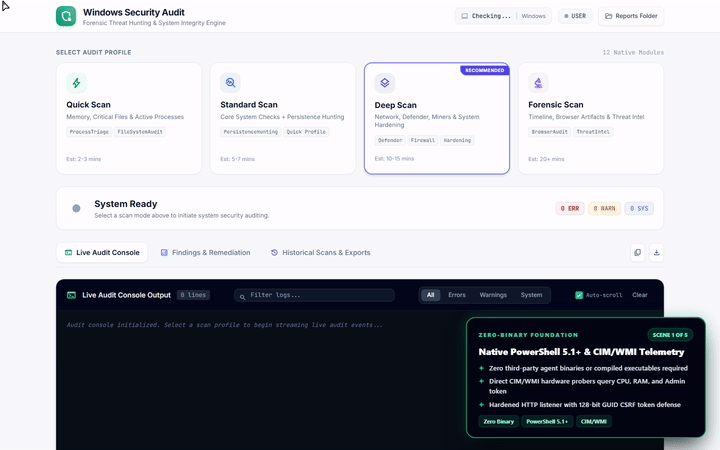
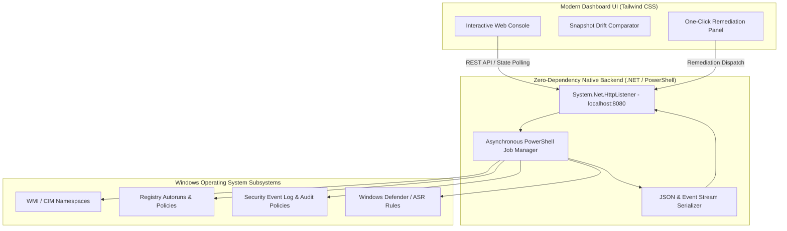

# Windows Security Audit Framework
### Enterprise-Grade Security Auditing, Forensics, & Threat Hunting for Windows Environments

[-brightgreen.svg)](#technical-architecture-zero-dependency-api)

---

> ### 🔒 Data Privacy & Verification Notice
> **Proprietary Codebase:** The complete source codebase for this project is hosted in a private repository to protect custom threat signatures, forensic modules, and system administration logic. 
> 
> **Live Verification:** This repository serves as the public system architecture map and technical documentation. I am highly comfortable performing a live, end-to-end system demonstration and code walk-through during an interview to verify all architectural implementations and logic flows.

---

## 🎥 System Walkthrough & Interactive Demo

  
  
<em>Click the preview above or <a href="media/windows_security_audit_walkthrough.mp4">click here to watch the full HD video walkthrough (MP4)</a>.</em>

---

## 🏛️ Executive Summary

The **Windows Security Audit Framework** is an enterprise-grade, PowerShell-based security auditing and threat-hunting engine equipped with a modern, responsive Web Dashboard. 

Designed to map live Windows workstation and server states directly to **CIS Benchmarks**, **NIST Special Publication 800-53**, and **POPIA Section 19** security safeguarding mandates, it performs deep forensic triage and system integrity checks without requiring heavy third-party agent installations or external cloud infrastructure.

---

## ⚙️ Technical Architecture: Zero-Dependency API

A key engineering breakthrough of this framework is that it operates with **zero external web server dependencies** (no IIS, Apache, Node.js, or Python installations required on the target machine). It hosts its backend REST API directly from a live PowerShell session leveraging native .NET runtime primitives.

---

## 🔍 Core Diagnostic Capabilities

- **Deep Process Triage:** Detects process injection, unsigned binaries executing from user-writable directories (`AppData`, `Temp`), and fileless malware by scanning heuristic checks against CIM/WMI namespaces.
- **Persistence Hunting:** Scans WMI event consumers, Registry Run/RunOnce keys, Startup folders, and Windows Scheduled Tasks for unauthorized backdoors.
- **Forensic Timeline Analysis:** Audits browser extensions, local `HOSTS` file modifications, PowerShell execution logs, and recent system execution timelines.
- **Crypto Miner Detection:** Identifies abnormal background CPU consumption patterns, masked processes, and known mining signature hashes.
- **System Hardening Audit:** Inspects User Account Control (UAC), Secure Boot, TPM status, BitLocker encryption, Attack Surface Reduction (ASR) rules, and Windows Defender active configurations against enterprise baselines.

---

## 📊 Scan Profiles & Execution Modes

| Profile | Typical Duration | Scope & Focus Area |
| :--- | :--- | :--- |
| **⚡ Quick** | 1–2 min | Memory integrity, active process triage, critical system files, and Defender state. |
| **📋 Standard** | 4–6 min | Core checks + full Persistence Hunting (Autoruns, Scheduled Tasks, WMI subscriptions). |
| **🔍 Deep** | 8–12 min | Comprehensive audit: Network listeners, firewall state, BitLocker, and OS hardening. |
| **🔬 Forensic** | 15+ min | Exhaustive investigation: Timeline analysis, verbose event logs, and threat hunting. |

---

## 🛡️ Compliance Mapping & Drift Analysis

### Standard Framework Alignments
Every finding is tagged with specific compliance cross-references:
- **CIS Controls v8:** Workstation baseline configuration, logging, and account control.
- **NIST CSF / SP 800-53:** Access control (AC), system and communications protection (SC).
- **POPIA Section 19:** Mandatory security measures on integrity and confidentiality of personal data.

### Baseline Snapshot Drift Comparator
Allows security analysts to capture a baseline snapshot of a clean system and compare subsequent scans to immediately pinpoint newly introduced registry persistence, modified services, or disabled security controls.

---

## 🛠️ Technology Stack & Requirements

- **Backend Engine:** Windows PowerShell 5.1+ / PowerShell 7+ (leveraging native .NET Framework `System.Net.HttpListener`).
- **Frontend UI:** HTML5, modern vanilla JavaScript, Tailwind CSS (light/dark adaptive styling).
- **Reporting Engine:** Automatic generation of responsive HTML reports, machine-readable JSON schemas (for SIEM ingestion), and CSV summaries.
- **Target OS:** Windows 10 & Windows 11 (Home, Pro, Enterprise, and Education editions).

---

Architected and maintained by **Sandiso Mazibuko**.
